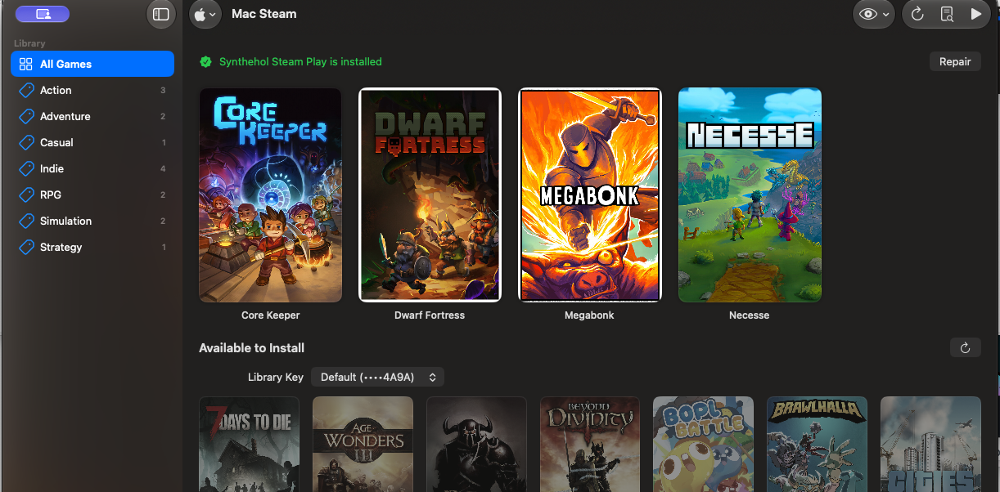

# Synthehol

**Play Windows Steam games on an Apple Silicon Mac without turning Wine into a hobby.**

Synthehol gives Windows games a Mac-native home: it creates and manages isolated
Wine configurations, installs Steam, discovers your library, downloads artwork,
and launches games from a poster grid. It can also add Steam Play support to your
existing macOS Steam installation, so Windows-only games can live beside your Mac
games.



> [!WARNING]
> Synthehol is under active development. Compatibility varies by game, and Steam
> or macOS updates may temporarily break the native Steam integration. Keep game
> saves backed up and expect rough edges.

## Why Synthehol?

Running a Windows game on macOS usually means choosing between a polished paid
product such as CrossOver and assembling Wine wrappers, prefixes, translation
layers, launch arguments, and per-game fixes yourself. The latter can work very
well, but it asks every player to become their own compatibility engineer.

Synthehol automates that work while keeping the pieces visible and configurable:

- Create separate Wine configurations without hand-editing prefixes.
- Download a checksum-verified Wine runtime and install Steam from the app.
- Browse installed games and games in your Steam library that are available to
  install.
- Launch Windows games from Synthehol or from generated macOS launcher apps.
- Use per-game graphics, sync, launch, artwork, and debugging options.
- Read Wine logs from the app when a game crashes or hangs.
- Use Windows games from the regular macOS Steam client through Synthehol Steam
  Play.

Synthehol does not include Windows, Steam games, or a Steam account. You are
responsible for the software licenses attached to the games and runtimes you use.

## Requirements

- An Apple Silicon Mac (M1 or newer)
- macOS 15 or newer for Synthehol itself
- Rosetta 2
- A Steam account for Steam games
- macOS 27 or newer when using Game Porting Toolkit 4 / D3DMetal

## Install

1. Download the latest `Synthehol-*-macOS.dmg` from
   [GitHub Releases](https://github.com/Synthehol-Gaming/Synthehol/releases), or
   use the development disk image in [`dist/`](dist/).
2. Open the disk image and drag **Synthehol** to **Applications**.
3. Open Synthehol. Prerelease builds are Developer ID signed but not yet
   notarized; if macOS blocks the first launch, approve it in **System Settings
   → Privacy & Security**.
4. Let Synthehol install Rosetta 2 if it is missing, then choose **Create
   Configuration…**.
5. Select **Download Runtime**, create the configuration, and choose **Install
   Steam**. Sign in through Steam's own window; Synthehol never handles your
   Steam password.

To use the regular macOS Steam installation instead, install Steam in
`/Applications`, create at least one Synthehol configuration with Steam installed,
then open **Mac Steam** in Synthehol and select **Install** for Synthehol Steam
Play. macOS may ask you to allow Synthehol under **System Settings → Privacy &
Security → App Management** because this integration updates the local Steam app.

If Windows games show **Cloud Status: Out of sync**, use **Install or Repair**
on Synthehol's Mac Steam page, restart Steam, and reselect **Synthehol Steam Play**
in the game's **Properties → Compatibility** settings. Updated tools include the
internal `proton` marker Steam requires to resolve Windows cloud-save folders
inside the game's prefix. Existing selections may still reference the old tool.
Wait for Steam's cloud sync to finish before playing; repairing the integration
does not delete game saves or prefixes.

If a game reports that its prefix needs rebuilding, fully quit the game and
Steam. In **Mac Steam**, right-click the game and choose **Game Settings… →
Rebuild Prefix**. Synthehol retains the complete original prefix as a backup and
copies game data outside the Windows system folder into the replacement. Reopen
Steam and launch the game to recreate Windows system files and registry settings.
Use **Show Prefix Backup** in the settings sheet to access the original files.

## Game Porting Toolkit 4

Synthehol supports Apple's **Game Porting Toolkit 4** and its D3DMetal libraries
for Direct3D 9–12. These libraries are optional and are **not bundled with
Synthehol**. Apple's license requires you to download them separately from the
[Apple Developer Game Porting Toolkit page](https://developer.apple.com/games/game-porting-toolkit/).

To enable D3DMetal:

1. Download Game Porting Toolkit 4 from Apple and open its evaluation-environment
   disk image.
2. In a Synthehol configuration, open **Settings → Graphics**.
3. Select **Install Wine 11.15 GPTK Runtime**.
4. Select **Import GPTK 4…** and choose the mounted toolkit when prompted.
5. Choose **D3DMetal (GPTK 4)** as the graphics backend.

The current importer accepts GPTK 4 beta 2 or newer. GPTK 4's D3DMetal path
requires macOS 27; DXMT and DXVK remain available for configurations that do not
use it.

## Inspired By

| Project | What it does | What Synthehol uses from it |
| --- | --- | --- |
| [NotProton](https://github.com/NotProtonNot/NotProton) | Adds a Proton-style compatibility layer to the native macOS Steam client so it can install and launch Windows games. | The architecture and incorporated components behind Synthehol Steam Play: Steam injection, compatibility-tool registration, launch bridging, overlay support, and Windows-game availability in the Mac Steam library. Synthehol embeds and extends these pieces, so users do not need NotProton installed. |
| [Recall](https://github.com/AsherJN/recall) | Builds a tuned Wine and DXMT gaming environment for Apple Silicon, with work focused on frame pacing, shader compilation, input latency, and runtime performance. | The optional performance-runtime design and vendored, hash-pinned DXMT/Wine patches for triple buffering, persistent Metal shader caching, eager shader preparation, parallel shader compilation, early shader-IR release, frame pacing, and supporting Wine improvements. Synthehol adds capability-gated per-game profiles so stock runtimes safely fall back to their normal behavior. |

The incorporated projects retain their own license terms. NotProton's GPLv3
code and separately licensed Steam/Proton-derived components are documented in
[`ThirdParty/NotProton-NOTICE.md`](ThirdParty/NotProton-NOTICE.md) and
[`NativeSteamCompatibility/Upstream/`](NativeSteamCompatibility/Upstream/).
Recall's Apache 2.0 attribution and the upstream licenses of its Wine/DXMT
patches are retained under [`PerformanceRuntime/Recall/`](PerformanceRuntime/Recall/)
and documented in
[`PerformanceRuntime/THIRD_PARTY_NOTICES.md`](PerformanceRuntime/THIRD_PARTY_NOTICES.md).

## Build from source

The app requires Xcode and [XcodeGen](https://github.com/yonaskolb/XcodeGen):

```sh
brew install xcodegen
xcodegen generate
DEVELOPER_DIR=/Applications/Xcode.app/Contents/Developer \
  xcodebuild -project Synthehol.xcodeproj -scheme Synthehol build
```

Run the non-UI package tests with:

```sh
cd SyntheholKit
DEVELOPER_DIR=/Applications/Xcode.app/Contents/Developer swift test
```

The generated `Synthehol.xcodeproj` is intentionally not committed. See
[`PLAN.md`](PLAN.md) for architecture, implementation status, and known
compatibility constraints.

## License and acknowledgments

Synthehol's original code is available under the [MIT License](LICENSE).
Incorporated third-party code remains governed by its own license and
attribution files and is not relicensed under MIT. Synthehol also builds on the
work of Wine, Valve Proton, DXVK, DXMT, Whisky, and their contributors.

> Synthehol: all of the flavor, none of the side effects.
